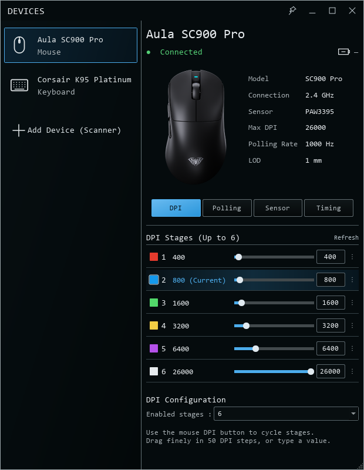
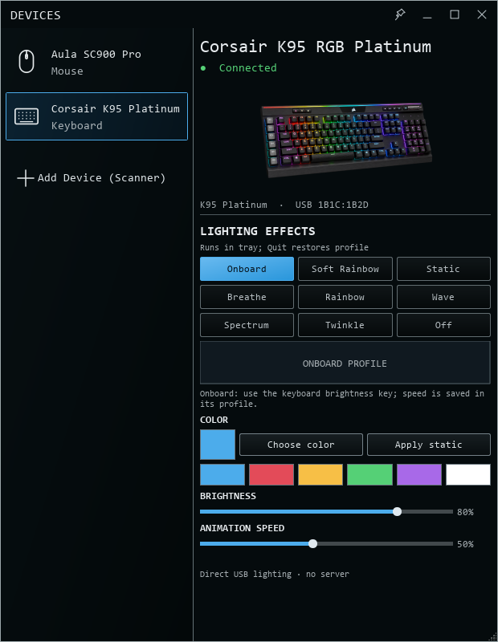

# PeriHub

A compact Windows tray app for the **AULA SC900 Pro** and **Corsair K95 RGB Platinum**.

**[Download the Windows installer](https://github.com/Saad176/perihub/releases/latest/download/Devices-0.6.1-Setup.exe)** · **[View releases](https://github.com/Saad176/perihub/releases)**

---

## Get started

1. Download **Devices-0.6.1-Setup.exe** from the link above or the latest release's **Assets** section.
2. Run the installer.
3. Open **Devices** from your Windows Start menu.

**That single Setup EXE includes everything needed to run the app.** No Python install, terminal, AULA software, iCUE or OpenRGB required.

PeriHub is the new project name. This first build still uses **Devices** in its window, Start menu entry and installer filename.

## Interface

<table>
<tr><td width="50%" align="center"><b>Mouse controls</b></td><td width="50%" align="center"><b>Keyboard lighting</b></td></tr>
<tr><td></td><td></td></tr>
</table>

*Representative interface previews use fixture data. Live connection, battery and settings depend on your hardware.*

## Supported devices

| Device | Connection | Controls |
| :--- | :--- | :--- |
| **AULA SC900 Pro** | Original 8K receiver or USB wired | 1–6 DPI stages, polling, sensor mode, LOD, Motion Sync, Ripple Control, Angle Snapping, debounce and dormancy |
| **Corsair K95 RGB Platinum** | USB | Onboard restore, Static, Breathe, Rainbow, Soft Rainbow, Wave, Spectrum, Twinkle and Off; brightness, speed and color where applicable |

### Mouse

- Type a DPI value, use arrow keys or drag finely in **50-DPI increments**.
- Configure the stage count and use the physical mouse DPI button to cycle stages.
- Select **125 / 250 / 500 / 1000 / 2000 / 4000 / 8000 Hz** polling.
- See battery percentage in the app and tray hover text.
- Switch between the original receiver and wired USB; wired takes priority when both are connected.
- Mouse writes run in the background with relevant settings readback checks.

### Tray and lighting

- Transparent white outline tray icon.
- One running instance per Windows user.
- Optional **Start with Windows** from the tray menu or installer.
- Keyboard software animations continue while the window is hidden.
- Normal **Quit** restores the keyboard's saved onboard lighting.
- Device and mouse-tab selections are remembered.

## Common questions

**Does closing the window exit the app?**  
Closing hides it in the tray. Right-click the tray icon and select **Quit** to exit completely.

**Why is battery unavailable at first?**  
Battery reports can take several seconds to arrive. Readings become unavailable after two minutes without a valid report.

**Why does changing polling briefly pause the mouse?**  
The mouse can reconnect while applying a polling change. Commands run off the UI thread.

**Can I use it with other devices?**  
Only the two devices listed above are supported by this release. Bluetooth, button remapping, macros, mouse LED modes, profile editing and firmware flashing are not verified or implemented.

**What are the Source code ZIP and TAR downloads?**  
GitHub generates those automatically. This is the public download repository, so its archives contain the page files, not the application source or installer. Download the **Setup EXE** to get the app.

## Feedback

[Open an issue](https://github.com/Saad176/perihub/issues) with your Windows version, exact device model, connection type, app version and steps to reproduce the problem. Avoid posting personal account information.

## About

An independent project by **Saad176**, verified on the developer's SC900 Pro and K95 Platinum. Compatibility with every PC and firmware revision has not been established.

PeriHub is not affiliated with AULA or Corsair. Third-party artwork and components retain their respective rights. The source is maintained separately; this repository does not grant an open-source license.
